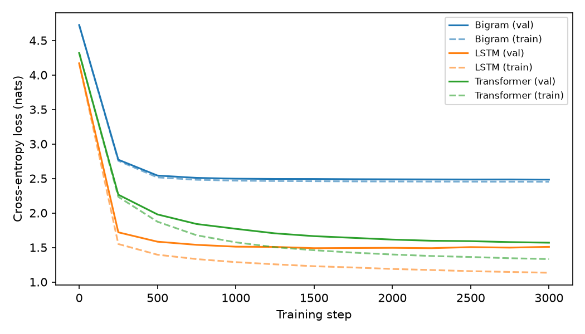
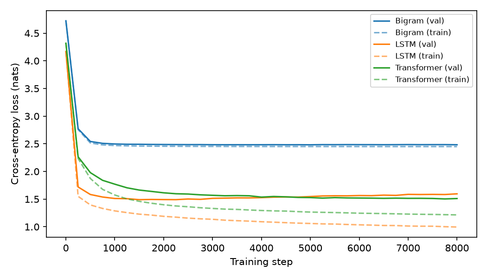

# Midterm Project: Bigram vs. LSTM vs. Small Transformer

Three character-level language models trained on Tiny Shakespeare under the same conditions, compared
on training loss, validation loss, training time and generated text.

**Main result:** going from the bigram (one character of context) to either model with real context cut
validation loss from 2.48 to about 1.5. That was by far the biggest improvement. Between the LSTM and the
transformer the result was close. The LSTM learned faster and reached the lowest validation loss
(1.490), but then overfit. The transformer learned more slowly, overfit much less, and finished a long
8,000-step run ahead (1.511 vs. 1.596).

## 1. What NLP task did I solve?
Next-character prediction (character-level language modelling): given the previous characters, predict
the next one. All three models are trained on this one task and evaluated the same way (average
cross-entropy loss on the next character).

## 2. Dataset
**Tiny Shakespeare**: 1,115,394 characters of Shakespeare plays, with a 65-character vocabulary (letters,
punctuation, space, newline).

- Source: https://raw.githubusercontent.com/karpathy/char-rnn/master/data/tinyshakespeare/input.txt
- A copy is included as `input.txt`. If it is missing, `midterm_lm.py` downloads it automatically.
- Split: the first 90% of the text is used for training (1,003,854 characters) and the last 10% for
  validation (111,540 characters). Splitting by position, not at random, means validation text comes
  from scenes the models never saw.
- Tokenizer: one token per character (65 tokens).

## 3. The three models and how they work

### Model 1: Bigram (4,225 parameters)
A 65 × 65 lookup table. The row for the current character holds a score for every possible next
character, and training adjusts these scores to match how often each pair of characters occurs.

- **What it uses:** only the identity of the current character.
- **What it ignores:** everything before that: the rest of the word, the line, the speaker and the
  position in the text. After `e` it predicts the same thing whether the text was `th` + `e` or the start
  of `every`.
- **Why that limits it:** it can learn which letter pairs are common (`th`, `he`, `e ` at the end of words),
  but it has no way to spell a whole word, because spelling depends on more than one previous character.
  More training does not help. Its validation loss was flat at about 2.48 from step 1,000 to step 8,000.

### Model 2: LSTM, a non-transformer model (946,625 parameters)
Each character is turned into a 128-number embedding and fed, one at a time and in order, through a
2-layer LSTM with a 256-number hidden state. A linear layer turns the hidden state into scores for the
next character.

- **How it uses more context:** the hidden state is a running summary of every character read so far in
  the 128-character window. The LSTM's gates decide what to keep, overwrite or forget at each step, so
  a character many steps back can still affect the prediction.
- **What it improves:** validation loss fell from 2.48 (bigram) to 1.49. The samples contain real words,
  real character names and the play's layout (`NAME:` on its own line, then the speech).
- **Why it still struggles with long dependencies:** all past information has to be squeezed into one
  fixed-size state and passed through every intermediate step. Details from far back get overwritten,
  and the training signal (gradient) for far-back characters weakens as it travels back through many
  steps. Processing is also strictly one character after another.

### Model 3: Small transformer (826,433 parameters)
A decoder-only (GPT-style) transformer with 4 layers, 4 attention heads and 128-number vectors.

- **Token embeddings:** each character becomes a learned 128-number vector.
- **Positional information:** a learned 128-number vector for each position 0–127 is added to the token
  embedding. Attention on its own does not know the order of the characters, so this tells it where each
  character sits.
- **Self-attention:** at each position the model builds a *query* (what am I looking for?), a *key* (what do
  I contain?) and a *value* (what do I pass on?). Each position compares its query with the keys of all
  positions, turns the scores into weights with softmax, and takes the weighted average of their values.
  A **causal mask** blocks positions from looking at later characters, so the model cannot see the answer.
  The 4 heads do this in parallel, so different heads can look for different things.
- **Feedforward layer:** after attention, each position goes through a small 2-layer network
  (128 → 512 → 128, GELU) on its own. Attention gathers information, the feedforward layer processes it.
- **Output layer:** a final LayerNorm and a linear layer turn each position's vector into 65 scores, one
  per possible next character.

Each layer also uses LayerNorm, residual (skip) connections and 10% dropout, which keep training stable.

## 4. Training setup (identical for all three models)

| Setting | Value |
|---|---|
| Batch size / context length | 64 sequences × 128 characters |
| Training steps | 3,000 (main run) and 8,000 (longer run) |
| Optimizer | AdamW, gradient clipping at 1.0 |
| Learning rate | Bigram 1e-2, LSTM 3e-3, Transformer 1e-3 (each architecture needs a different one) |
| Evaluation | every 250 steps, on the same 50 fixed batches of train and validation text for every model |
| Random seed | 1337, reset before building each model and before generating each sample |
| Text generation | 600 characters, temperature 1.0, starting from a newline |
| Hardware | Apple-silicon Mac GPU (PyTorch 2.15.0, MPS backend) |

Training time counts only the optimizer steps, not evaluation.

## 5. Results

### Main run: 3,000 steps each

| Model | Params | Train Loss | Validation Loss | Training Time | Generated Text Quality | Notes |
|---|---|---|---|---|---|---|
| Bigram | 4,225 | 2.453 | 2.484 | 3.1 s | Low | Flat at ~2.48 from step 1,000 on. Letter pairs, almost no real words. |
| LSTM | 946,625 | 1.134 | **1.509** | 90.0 s | Medium | Lowest val loss here. Best val 1.490 at step 1,500, then overfits. |
| Transformer | 826,433 | 1.332 | 1.569 | 141.8 s | Medium | Val loss still falling at step 3,000. More invented words. |



### Longer run: 8,000 steps each
The transformer was still improving at step 3,000, so I trained all three models again for 8,000 steps
with every other setting unchanged.

| Model | Train Loss | Validation Loss | Best Val Loss (step) | Training Time | Train–Val Gap |
|---|---|---|---|---|---|
| Bigram | 2.450 | 2.483 | 2.482 (5,000) | 8.4 s | 0.03 |
| LSTM | 0.996 | 1.596 | **1.490 (1,500)** | ~249 s* | 0.60 |
| Transformer | 1.215 | **1.511** | 1.504 (7,750) | 385.9 s | 0.30 |

\*The Mac went to sleep during the LSTM's run, so its measured time includes the sleep. ~249 s is
calculated from the speed after it woke (31.1 ms per step), which matches the 3,000-step run (30.0 ms per
step). Sleep does not affect the losses. Details: `runs/8000_steps/results.md`.



The transformer's validation loss passes the LSTM's at about step 4,750 and stays ahead to the end.

### Generated samples
Full samples are in `samples/` (3,000 steps) and `runs/8000_steps/samples/` (8,000 steps). Excerpts:

**Bigram** (3,000 steps): plausible letter pairs, almost no words.
```
Thaysntherelioscthithandin.
ANombed oulouel RIO:
Thid n tur go m,
```

**LSTM** (3,000 steps): real words, real character names and correct play layout.
```
POLIXENES:
That, bloody, three day no sort that
sayest you into gracious drum.

VOLUMNIA:
What news?
```

**Transformer** (3,000 steps): same structure, but more made-up words (`sacreth`, `heavion`, `gliberch`).
```
That not Margaret England, sight she is the pride.
Thou dost justs make blood devise with Angelo;
That sacreth Camillo's denied drunk'd and the heavion
```

**After 8,000 steps** the LSTM and transformer samples read about equally well:
```
LSTM:         Then do I justify all hoped, by this,
              Thou call'dst me as lose in person king's hour,
              And Warwick be thy son with a limb!

Transformer:  KING RICHARD III:
              O Lord of Hereford, to die by God;
              O, brind, were fearful so, and not I poison him.
```

Neither model keeps a meaning going for more than a line or so. Both have learned spelling, names,
punctuation and the shape of dialogue, but not sense.

## 6. Analysis

**Which model performed best?**
On validation loss the LSTM narrowly did: its best was 1.490 (step 1,500) against the transformer's best of
1.504. That gap is small. In the 3,000-step run the LSTM also finished lower (1.509 vs. 1.569). Over 8,000
steps the transformer finished lower (1.511 vs. 1.596), because the LSTM overfit. Both are far ahead of the
bigram (2.48). In perplexity terms the bigram is as unsure as choosing among about 12 characters,
the other two among about 4.5.

**Which model trained fastest?**
The bigram: 3.1 s for 3,000 steps, but it stops improving almost immediately. Of the two real models the
LSTM was faster both per step (30 ms vs. 47 ms) and in steps needed. It reached 1.72 validation loss after
250 steps, where the transformer was at 2.27.

**Which model generated the most realistic text?**
At 3,000 steps the LSTM's, with fewer invented words, which matches its lower loss. At 8,000 steps the LSTM
and transformer samples are about equally good, so both are rated Medium. One 600-character sample per
model is weak evidence, so this judgement is less reliable than the loss numbers.

**What did the transformer improve compared to the other models?**
Compared to the bigram, it uses the full 128-character context, which cut validation loss by about 1.0.
Compared to the LSTM, it overfit much less. At 8,000 steps its train–val gap was 0.30 against the LSTM's 0.60,
and its validation loss kept falling for the whole run while the LSTM's rose after step 1,500.

**Was the improvement worth the added complexity?**
At this scale, mostly not. The transformer takes more code, about 1.6× the time per step, and more steps to
reach the same loss, and it never beat the LSTM's best validation loss. Its real advantage, steady
improvement without overfitting, would only matter with a longer training budget, or with more data and
bigger models than this experiment used.

**What did I learn about attention?**
Attention lets every position look directly at any earlier position and decide by content what to use,
instead of relying on a summary passed along step by step. That flexibility has a cost. Attention has no
built-in idea of order (it needs positional embeddings) or of "recent characters matter most" (the LSTM gets
that for free from how it is built). So the transformer had to learn those things from data, which is why
it started more slowly.

## 7. What I learned from this project
- **Context is the biggest win.** Going from one character of context to 128 matters far more than which
  architecture uses that context.
- **One training budget can give the wrong answer.** At 3,000 steps the LSTM wins. At 8,000 steps the
  transformer wins on final loss. At each model's best checkpoint the LSTM wins narrowly. Looking at the
  whole loss curve was necessary to see what was actually happening.
- **Validation loss is the number that matters.** By the end the LSTM had the lowest training loss (0.996) and
  the worst validation loss of the two real models (1.596), which is overfitting.
- **Timing measurements are fragile.** The laptop sleeping during a run made one training time meaningless
  until it was recalculated.

## 8. Reflection: what makes transformers powerful for language modelling?
After comparing the three models, I think the transformer's power comes from **direct, content-based
access to context**. The bigram sees one character. The LSTM sees everything, but only through a single
256-number summary that is rewritten at every step, so information from far back has to survive many
updates. Attention removes that bottleneck. Each position can look straight at whichever earlier characters
are relevant and weight them by how well they match what it is looking for. Stacking layers and heads lets
the model combine many such lookups.

This experiment also showed that this power is not free. With only about a million characters, the
transformer needed more steps than the LSTM and finished roughly tied with it. Because attention has fewer
built-in assumptions, it has to learn more from data. What I take from this is that transformers are
powerful mainly because that flexibility keeps paying off as data, model size and context length grow, and
because every position in a sequence is computed at once instead of one after another. That scale is much
larger than this project could test. My result shows the start of that: the transformer kept improving
after the LSTM had started to overfit.

## 9. Responsible AI use
I used Claude (claude.ai and Claude Code) on this project. `ai_use_summary.md` lists exactly what Claude
did, including drafting the explanations and analysis in this README, and what I did myself.

## Reproduce
Tested with Python 3.13.
```bash
python -m venv .venv && source .venv/bin/activate
pip install -r requirements.txt
python midterm_lm.py                                         # main 3,000-step run (~4 min on an Apple-silicon GPU)
python midterm_lm.py --steps 8000 --out_dir runs/8000_steps  # longer run (~12 min)
python midterm_lm.py --steps 300                             # quick test
```
The script picks CUDA, Apple MPS or CPU automatically (`--device` overrides it). Results on Apple's MPS
backend are not perfectly repeatable: rerunning gave the LSTM 1.514 instead of 1.509 at step 3,000.
Keep the computer awake during a run, or the training times will be wrong.

## Repository contents
| Path | What it is |
|---|---|
| `midterm_lm.py` | Data loading, the three models, training, evaluation and text generation |
| `input.txt` | Tiny Shakespeare dataset |
| `results.md`, `loss_curves.png`, `samples/`, `run_log.txt` | Output of the 3,000-step run |
| `runs/8000_steps/` | Output of the 8,000-step run |
| `ai_use_summary.md` | How AI was used in this project |
| `requirements.txt` | Python packages (pinned versions) |
